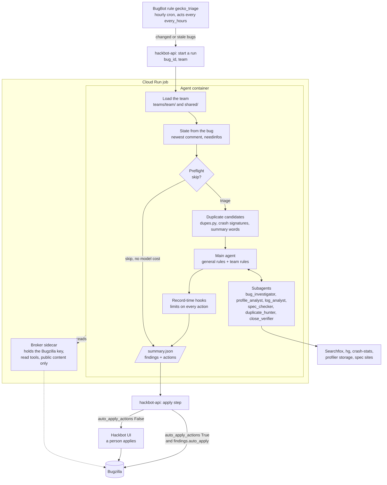

# gecko-triage agent

Triages one Gecko bug per run and keeps no memory of its own. A team, such as media, adds
its own rules. With no team, the run uses the shared rules for the bug's component. It inventories what the report contains. It reads the diagnostics reporters attach:
Firefox Profiler captures, logs, crash reports and specs. It records one comment plus
the field changes it is allowed. These are severity and priority when they are unset,
needinfo flags, a meta bug in `blocks`, keywords, `regressed_by`, `see_also`, fix tags in
the whiteboard, a component move and a resolution. On a duplicate, it also adds the team meta bug to the `dupe_of` bug. A bug
runs again when someone changes it. Each run reads the whole bug, with all comments, and
decides from it the status, what is missing and the next step. Who asked for what does
not matter.

A run can name a team. The team decides the components, the capture steps, the
needinfo experts, the meta bugs and the team rules. An unknown team name stops the run
with an error.

A run with no team uses only the general rules in `rules/` and the files in `shared/`.
Its scope is the bug's own component, in a product from the no-team list in
`shared/bugzilla.toml`. The preflight never skips the bug as out of scope. A move to the
owning component is still allowed. The run has no meta bugs, so the hooks refuse every
`blocks` change. It has no capture block and no needinfo experts. Such a run never
vouches for unattended apply, so a person always applies its actions.

| Doc                     | For                                                                         |
| ----------------------- | --------------------------------------------------------------------------- |
| `docs/bugzilla.md`      | People who see the agent on a bug: what it reads, changes and never sets    |
| `docs/configuration.md` | Maintainers and teams: the team directory, the shared files, manual or auto |
| `docs/testing.md`       | Maintainers: unit tests, the dry run, the image check, dev                  |

## Layout

| Path                                 | Holds                                                             |
| ------------------------------------ | ----------------------------------------------------------------- |
| `hackbot_agents/gecko_triage/rules/` | The general rules every team follows                              |
| `teams/<team>/team.toml`             | The team's components, capture steps and needinfo experts         |
| `teams/<team>/rules/`                | The team's rules: bug types, diagnostics, comment, S/P, meta bugs |
| `shared/bugzilla.toml`               | Bugzilla keywords and fields, and the agent's whiteboard tags     |
| `shared/people.toml`                 | How to tell Mozilla staff and QA apart                            |

Paths under `teams/` and `shared/` are relative to `hackbot_agents/gecko_triage/`.

## How a run goes



The agent never holds a Bugzilla key and never writes. It records actions; hackbot-api
applies them as `hackbot@mozilla.tld` and tags every comment `gecko-triage`.

| Mode          | Model auth                                                                                                                                                                                                                      | Bugzilla key                                                                                                                   |
| ------------- | ------------------------------------------------------------------------------------------------------------------------------------------------------------------------------------------------------------------------------- | ------------------------------------------------------------------------------------------------------------------------------ |
| Cloud Run job | Workload Identity Federation, with no Anthropic API key. The deploy sets the `ANTHROPIC_FEDERATION_RULE_ID` and the other ids, and the runtime writes the token file (`libs/hackbot-runtime/hackbot_runtime/anthropic_wif.py`). | A shared broker secret from Secret Manager. The Hackbot deploy in mozilla/webservices-infra sets it. Only the broker holds it. |
| Local, Docker | `ANTHROPIC_API_KEY` in the root `.env`                                                                                                                                                                                          | `BUGZILLA_API_KEY` in the root `.env`, given to the broker only                                                                |
| Local, host   | `ANTHROPIC_API_KEY` when the shell sets it, else the Claude Code login                                                                                                                                                          | `BUGZILLA_API_KEY` in the broker's terminal                                                                                    |

In every mode, the code limits the broker to read tools and public content. Nothing in
this repo shows that the cloud key is read-only. For a local run, use a key that cannot
read private comments.

1. `config.py` loads the team named by `TEAM` and the shared files. With no `TEAM`, it
   loads the shared files only. An unknown team or a bad file stops the run.
2. `state.py` reads the bug, all its comments and its open needinfos. A bug it cannot
   read fails the run, so BugBot retries it. A bug read that does not end in 3 minutes
   also fails the run. A history read that does not end in 2 minutes gives no history,
   and the agent runs.
   The user prompt gives the model the bug's fields and its public comments from this
   read, so the model does not read them again. `render_bug` in `agent.py` gives them
   as escaped JSON, so no comment text can pose as another comment, another author or
   a rule file. It drops a comment that is not marked public, also when the broker
   already dropped it, and fails the run when a thread with comments has none marked
   public. Over `COMMENTS_CAP` characters it leaves out the oldest automation
   comments, then the oldest other ones, keeps comment 0 and the newest, and names
   the left-out comments so the model can read them with `get_bug_comments`.
3. `preflight.py` ends the run, at zero cost, on the skips `docs/bugzilla.md` lists. A
   skipped run is `status: "ok"` with `num_turns: 0`, `decision: "skipped"` and the
   reason in `result`.
4. `dupes.py` searches the team's components for duplicate leads, and puts the best
   ones in the prompt for `duplicate_hunter` to check first. With no team, it searches
   the bug's own component. The "Duplicate search" section below tells how. The
   source checkout runs at the same time as this search.
5. The model triages the bug with the general rules and the team rules, and records its
   actions. With no team, it uses the general rules only. The system prompt carries
   every rule file, so it is the same for each run of a team and can be cached; the
   user prompt carries what differs per bug. The hooks in `hooks.py` check
   each action as it is recorded; their docstring lists the limits. A refusal reaches
   the model as a tool error it can correct in the same run, and nothing lands in
   `summary.json`.
   The main agent can fix an error in its recorded comment with
   `remove_recorded_actions`, an in-process MCP server (`rerecord.py`) bound to the
   recorder. It removes every recorded action, the `dupe_of` change too, and the agent
   records them again. Every hook runs again. The close verdicts stay, so a verdict
   after the first comment stays late. A run can use it 2 times. The `PreToolUse` hook
   `removal_caller_guard` refuses it to every subagent. That hook is the barrier: the
   CLI's built-in general-purpose agent has every tool, MCP tools too. A run that
   removed its actions and ends with no comment fails, unless its decision is
   `watching`, so BugBot runs it again.
6. `may_apply_unattended` in `agent.py` sets `findings.auto_apply` when the run has a
   team, the run recorded a comment and the final message carries a decision. A close
   also needs its confirm, as "Close verification" says. The
   hackbot-api entry has `auto_apply_requires_consent=True`; with
   `auto_apply_actions=False` every run waits for a person, and with `True` such runs
   apply with nobody in between.

A comment carries no memory line. Its last line is the runtime's reaction footer, and
the style limits skip that footer.

## Duplicate search

`dupes.py` runs all its searches through the broker. Every search sorts the newest bugs
first and sets a limit, so recent bugs are never lost. No search limits the status or
the age. The queries of one search run in parallel, within a time budget. A failed or
slow query is dropped, and the search never fails the run.

Before the model starts, two searches find the leads for the prompt:

- **Crash signature.** For each `[@ ...]` signature in `cf_crash_signature`, it finds
  the bugs with that signature as a substring, then keeps the bugs that have the same
  signature. A signature that 10 bugs or more have, such as `OOM | small`, is too
  generic and is dropped. These matches come first in the list.
- **Summary words.** It searches each content word of the summary, stemmed, as the start
  of a word in other summaries. It asks for up to 400 matches for each word, because the
  broker drops restricted bugs. A word with 300 public matches or more is too common, so
  it is dropped. It keeps the 8 rarest words. Each word
  that a bug matches adds a weight, and a rarer word adds more.

`duplicate_hunter` then calls the `search_concepts` tool, an in-process MCP server bound
to the triaged bug and its scope. The hunter gives 2 to 4 concepts. Each concept is a
list of synonym stems for one aspect of the symptom, such as
`[["fade", "fading", "ramp"], ["pause", "unpaus", "resum"], ["bluetooth", "headset"]]`.
The tool joins each pair of concepts, and all of them, with AND. A concept matches when a
word starts with one of its stems. It searches the summaries and the comment text, and
gives up after 30 seconds. A bug that matches more concepts ranks first, then a match in
the summary, then the newest bug. The tool returns 10 bugs and marks the meta bugs. The
record hooks refuse a meta bug as the `dupe_of` bug. A stem has 3 to 24 letters or
digits only, so it cannot change the query.

## Close verification

A wrong close is costly, so every close gets an independent check. Before the main agent
records the comment of a close, it spawns `close_verifier` with the bug id, the
resolution, `dupe_of` for a duplicate, its reasons and the draft comment. The verifier
starts with a fresh context and reads the bug, every comment, the cited code and the
duplicate target. It has the Bugzilla read tools except `get_bug_attachments`, and the
Searchfox and VCS tools. It has no Read, Grep, Glob or Bash, no attachment tool and no
write or action tool, and it never runs Firefox, a test or an attachment. When only a run can
confirm the close, it refutes with "needs a runtime check".

The bundled Claude Code CLI saves an MCP tool result that is too large, such as the
comments of a long bug or a large Searchfox file, to a file and tells the model to Read
it. The verifier has no Read, so it fails closed: it refutes with "a tool result was too
large to read, so the close cannot be verified", and the bug stays open for a person.
This is also enforced in code. A PostToolUse hook on the MCP tools (`spill_hook`) looks
for the CLI's notice in a verifier result: "exceeds maximum allowed tokens. Output has
been saved to", `<persisted-output>` or "Full output saved to:". Once it sees one, the
verdict tool refuses a `confirm` and still takes a `refute`. A result of the main agent
or another subagent sets nothing. The CLI returns a spill as a normal result, so
PostToolUseFailure needs no hook. The comment tool takes no page bounds, so the verifier
cannot read a long thread in parts.

The verifier records its verdict with `record_close_verdict`, an in-process MCP server
(`closing.py`) bound to the run's verdict store. A verdict is `confirm` or `refute`, with
the reasons and a list of corrections to the comment. A `PreToolUse` hook refuses the
tool to every caller but `close_verifier`, and another one allows one spawn of
`close_verifier` per run, and none after the comment. The last comment hook marks the
comment as recorded, and a verdict notes whether it came before the comment. The update
hook in `hooks.py` refuses RESOLVED unless the store holds a `confirm` for the same resolution and `dupe_of` that
came before the comment. It refuses every close after a `refute`. So a verifier that ends
with no verdict leaves the close refused, and a comment always comes after the verdict.
The main agent applies the corrections to the comment, also after a confirm. A move to
another component needs no verdict. A run with no team gets the same check.

A closing decision (`invalid`, `duplicate`, `incomplete`) or a recorded close vouches for
unattended apply only when the run recorded the close and `close_verification` is
`confirmed`. The decision must match the resolution: `invalid` goes with INVALID or
WONTFIX, `duplicate` with DUPLICATE and a `duplicate_of` equal to `dupe_of`, and
`incomplete` with INCOMPLETE. RESOLVED FIXED matches no decision, so a person checks it.
`close_warning` names any mismatch. It also names a verifier asked after the comment, and
a refused close that the run did not record after all, since then the comment can say
the bug closes while it stays open. The update hook keeps the resolution and `dupe_of`
of each refused update on the triaged bug that sets a status, a resolution or `dupe_of`,
whichever check refuses it. A retry that records the same close clears that warning; a
close with another resolution or another `dupe_of` does not. A duplicate of a bug that
was closed with a resolution other than FIXED, a duplicate chain too, also sets
`close_warning`: that target does not show that this bug is fixed. A duplicate of an
open bug does not. A run with a `close_warning` never vouches.

A known limit: no code ties the corrections to the comment text. The comment comes after
the verdict, so the main agent has the corrections when it writes it. A person checks the
comment in review.

## Subagents and skills

| Subagent           | Does                                                               | Skill (fx-bug-toolkit)    |
| ------------------ | ------------------------------------------------------------------ | ------------------------- |
| `bug_investigator` | Investigates the root cause before an "Analyzed" comment or an ask | `bug-start` (triage mode) |
| `profile_analyst`  | Reads one Firefox Profiler capture                                 | `analyze-profile`         |
| `log_analyst`      | Reads one log, attached, extracted or from CI                      | `check-log`               |
| `spec_checker`     | Checks a behavior against a spec, gives a verdict                  | `spec-check`              |
| `duplicate_hunter` | Searches for an existing report, with `search_concepts`            | none                      |
| `close_verifier`   | Tries to prove a proposed close wrong, before it is kept           | none                      |
| `investigator`     | Answers one read-only question                                     | none                      |

The main agent, `investigator`, `bug_investigator` and `log_analyst` read attachments
with the `fetch_attachment` tool (`attachments.py`), an in-process MCP server bound to the
triaged bug. It reads the attachment anonymously from `BUGZILLA_API_URL` (default
`https://bugzilla.mozilla.org/rest`) and refuses a private one, one of another bug and one
over 64 MiB. It writes to `/tmp/gecko-triage-attachments/bug-<bug>-<attachment>/` and adds
a row to `/tmp/gecko-triage-attachments/manifest.jsonl`. A second fetch of the same
attachment checks its metadata again, then returns the finished copy; a result that a
later call may improve (`retry`, such as a missing ffmpeg or a timeout) is not kept. It unpacks gzip, zip and tar files with caps
(256 MiB, 500 members, no links, no paths outside the folder) and writes archive members
under generated names. For up to 3 videos it runs `ffprobe` and extracts at most six
JPEG frames with `ffmpeg` (one frame when the duration is unknown), under CPU, memory
and time limits. The rules tell the model to fetch attachments only with this tool.

`log_analyst` alone reads CI logs, with the `fetch_ci_log` tool (`ci_logs.py`), an
in-process MCP server of its own. The server serves the whole session, so a PreToolUse
hook (`ci_logs.caller_guard`) refuses a call from the main agent or any other subagent:
it needs a subagent `agent_id` and the `log_analyst` agent type.
The tool takes a Taskcluster task id with an optional run, a `live_backing.log` URL on
`firefoxci.taskcluster-artifacts.net` or `firefox-ci-tc.services.mozilla.com`, or a
`treeherder.mozilla.org` link with `selectedTaskRun`, or with `job_id` or `selectedJob`
and `repo`. A link that names two different targets is refused. The link comes from bug
text, so the tool only parses it with `urllib.parse`: https only, the exact host, no user
name, no port, the exact log path and a run of one or two digits. A Treeherder job id is
mapped to its task with the Treeherder API (`/api/project/<repo>/jobs/<job_id>/`, fields
`task_id` and `retry_id`). The tool reads the task's run states from the Taskcluster
queue status. Without a run, it reads the newest completed or failed run, and a run that
ended in an exception only when no other run has finished, as such a run often has no
log. When the run it reads is not the newest, when no run has finished, or when the
status cannot be read, the result's `note` says which run it read and why. The
tool then downloads
`https://firefoxci.taskcluster-artifacts.net/<task>/<run>/public/logs/live_backing.log`
itself and never opens the given URL. That host serves the log directly, with gzip
content encoding, so no redirect is expected; a redirect is followed only to the same log
of the same task and run on that host, and any other redirect, or one with no
`Location`, is refused. A watchdog keeps a duplicate of the file descriptor of each
connection, redirects included, and shuts the connections of a fetch 120 seconds after
it starts, also over TLS, so a server that sends one byte at a time cannot hold it. A
reply that ends before its `Content-Length` is refused and not kept. One log stops past
64 MiB of decoded log ("too large, not read"). All the logs of a run share a budget of
256 MiB and 12 downloads, because `/tmp` on Cloud Run is memory. A second download of
a run that has not finished counts as one more, and the old copy counts until the new
one replaces it. The log goes to
`/tmp/gecko-triage-ci-logs/task-<task>-run-<run>.log`, with a row in
`/tmp/gecko-triage-ci-logs/manifest.jsonl`. The log of a finished run is read once and
then reused; a run that has not finished is fetched again, and `finished: false` marks
it. The prompt tells `log_analyst` never to use curl or WebFetch to fetch a log; Bash can
still reach the network, so that part is a rule, not a guard.

The image fetches the plugin at a pinned commit, and the run stops before the model if
the plugin version or a skill does not match `TOOLKIT_VERSION` and `TOOLKIT_SKILLS` in
`toolkit.py`. The session sets `FX_BUG_TOOLKIT_MODE=hackbot`, so each skill runs in its
Hackbot mode. In that mode, the skill uses the container's tools and skips the steps
that need a local machine. The skills' wiki steps are switched off. The session also sets
`FX_BUG_INVESTIGATION_DIR=/tmp/gecko-triage-investigations`. The `bug-start` skill must
write its investigation file, and the write guard allows writes only under `/tmp`. A
PreToolUse hook refuses Write and Edit on any other path. The job container discards the
file. On the host, it stays in /tmp. The image also has Node 24,
`@firefox-devtools/profiler-cli@0.11.0`, a static `webspec-index` and Debian's `ffmpeg`.

## Running it

With Docker, an Anthropic API key and a Bugzilla key in a gitignored `.env` at the repo
root (see `agents/README.md`). Use a Bugzilla key that cannot read private comments:

```sh
BUG_ID=<bug> TEAM=<team> docker compose up gecko-triage-agent --build
```

On the host without Docker (a dry run), the Claude Code CLI uses `ANTHROPIC_API_KEY` when
the shell sets it. Otherwise it uses the Claude Code login already on the machine. Install
`ffmpeg` on the host to read video attachments; without it, a video's `media` field gives
the error. Bugzilla reads use the key the broker holds, and the agent process never sees
it. The broker returns only public bugs, comments and attachments. "Why the agent reads
only public content" in `docs/bugzilla.md` gives the reason and the files that do it.

Terminal 1, the broker (reads only; nothing in this setup can write to Bugzilla):

```sh
BUGZILLA_API_URL=https://bugzilla.mozilla.org/rest \
BUGZILLA_API_KEY=<a key that cannot read private comments> \
uv run --package hackbot-agent-gecko-triage python -m hackbot_agents.gecko_triage.broker
```

Terminal 2, the agent, from the agent directory so the runtime finds `hackbot.toml`:

```sh
cd agents/gecko-triage
BUG_ID=<bug> TEAM=<team> \
BROKER_URL=http://127.0.0.1:8765 \
SOURCE_REPO=<a spare firefox clone> \
ARTIFACTS_DIR=<dir> \
FX_BUG_TOOLKIT_DIR=<fx-bug-toolkit checkout of the pinned release> \
uv run --package hackbot-agent-gecko-triage python -m hackbot_agents.gecko_triage
```

The run writes `<ARTIFACTS_DIR>/<run_id>/summary.json` (`findings` and the recorded
`actions`) and `logs/agent.log`. Nothing posts: the apply step only runs in hackbot-api.

The runtime's `prepare_repo` fetches and hard-resets whatever `SOURCE_REPO` points at.
Point it at a spare clone, never at a working tree. `profiler-cli` and `webspec-index`
must be on `PATH` for profile and spec reading.

## Inputs

| Env var              | Required | Meaning                                                                              |
| -------------------- | -------- | ------------------------------------------------------------------------------------ |
| `BUG_ID`             | yes      | The bug to triage                                                                    |
| `TEAM`               | no       | The team, `teams/<team>/`. Unset: the general rules only, in the bug's own component |
| `BROKER_URL`         | yes      | Bugzilla broker base URL; the agent appends `/mcp`                                   |
| `FX_BUG_TOOLKIT_DIR` | no       | The fx-bug-toolkit plugin checkout; the image sets `/opt/fx-bug-toolkit`             |
| `BOT_ALIASES`        | no       | Pilot only: comma-separated logins that count as the bot, like `hackbot@mozilla.tld` |
| `MODEL`, `EFFORT`    | no       | Model controls; the defaults are in `__main__.py`                                    |
| `MAX_TURNS`          | no       | Turn limit for one run; the default is in `agent.py`                                 |
| `MAX_BUDGET_USD`     | no       | Cost limit for one run, subagents included; the default is in `agent.py`             |

The bot accounts are `hackbot@mozilla.tld` and the logins in `BOT_ALIASES`. The agent
never sends a needinfo to a bot account. When the agent wrote the newest comment and
nothing that changes the analysis happened after it, the preflight skips the bug. A CC
change, for example, does not count. A person added to CC this way can get a needinfo
only after the next change that counts. A `hackbot@mozilla.tld` comment
counts as the agent's only with the `gecko-triage` tag, since other Hackbot agents post
as that account too. An alias comment counts with or without the tag. `BOT_ALIASES`
stays out of the repo, because the alias account is temporary.

## Output

`findings` carries `decision` (`needs_info`, `analyzed`, `duplicate`, `invalid`,
`wrong_component`, `incomplete`, `stalled`, `watching`, or `skipped` from the
preflight; an analyzed or needs-info run that records no action is `watching`, and
a close, a move or `stalled` with no action fails the run, unless it planned a
close that `close_verifier` refuted, which makes it `watching`), `asked`, `unread`, `severity`, `priority`, `needinfo`, `meta_bug`,
`duplicate_of`, `issue_type`, `issue_type_note`, `issue_type_warning`,
`close_verification`, `close_warning`, `needinfo_warning`, `restricted_warning`,
`fix_tags`, `auto_apply` and `agent_version`. `actions` carries the recorded comment and field
changes. After the session, the run reads the `dupe_of` bug, the `regressed_by` and
`see_also` bugs, the bugs the comment names and the commit message bugs through the
broker. The run drops a change on any other bug. It also drops
a change on a `dupe_of` bug that is closed, a meta bug or out of scope. Then `result` names the dropped change and
`auto_apply` is false. A duplicate of a restricted or unreadable bug fails the run.

`analyzed` means the run found the problem and a fix direction, and asks nobody for data.
When an expert leads the analysis, the run posts only confirmed facts or a field change, as
`rules/workflow.md` says under "An expert leads the analysis".
`needs_info` means the bug still waits for data. The run sets severity and priority in
both cases. `asked` lists the data the run asked for, never a developer hand-off. A run
that ends with `analyzed` and an item in the plan's `asked` fails, and BugBot runs it
again. A run that ends with `analyzed` and a needinfo on a reporter who is not a
developer also fails, because that needinfo asks for data. The capture check does not
fail a run. The hook checks each comment when the agent records it. It refuses a comment
that retypes the capture steps. It also refuses a comment that asks for the capture
without the verbatim block.

`issue_type` is the bug's main symptom, for a dashboard: one value from the team's
`[[issue_types]]` in `team.toml`, or `other`. `issue_type_note` names the symptom in a
few words with `other` only, cut to 60 characters, and is null otherwise. It is a label,
so it never fails a run. A missing or unknown value, `other` with no note, a note with an
email address, or any value on a run with no list sets both to null, and
`issue_type_warning` says why. It is null when the value stands.

`fix_tags` lists the whiteboard tags the run added, `[gecko-triage:easy-fix]` and
`[gecko-triage:gfb-candidate]`, so a dashboard can list the bugs whose fix looks small.
It is empty when the run added none. The agent sends `{"add": [<tag>]}`, and the hook
records the bug's whole whiteboard with the tags at its end, since Bugzilla replaces the
whole text. The hook refuses any other whiteboard change. The decision comes only in the
final message, so the post-run check drops the whiteboard change of a run that is not
`analyzed`. Then `result` names the drop. The drop alone does not hold the run for a
person, since the rest of the run passed its checks.

`close_verification` is `refuted` when `close_verifier` refuted a close in the run, and
`confirmed` when its confirm covers the close the run recorded, the same resolution and
`dupe_of`. Otherwise it is null. `close_warning` says why a person must check the close,
as "Close verification" lists, and is null otherwise.

`needinfo_warning` is set when the run asks a commit author, whose hg email may not be a
Bugzilla login. The run may instead ask the @mozilla.com assignee of a bug that the
commit message names, when the assignee's real name is the commit author's name. Then
`needinfo_warning` asks a person to check that this person wrote the commit.
`restricted_warning` lists the bugs of the post-run read that are restricted or
unreadable, or every one when the read failed, so that a person checks that the comment
does not name or describe them. It also lists each bug that the broker withheld from a
read during the run, by the main agent or a subagent: an `inaccessible` id of
`get_bugs`, or a bug that a read refused with `access_denied`. A comment that contains
the number of such a bug fails the run. The run reads a `get_bugs` result that the CLI
saved to a file only from the CLI's `tool-results` folder, up to 32 MiB. When it cannot
check that file, or a `get_bugs` result that is not an error has no `inaccessible` list,
`restricted_warning` says so. The gate fails safe: a mistyped id in a read also holds
the run, and the number check can match an unrelated number, such as a timestamp. Either
warning sets `auto_apply` to false.

`agent_version` names the code that made the run, on every run that returns findings,
skipped runs included. A failed run raises and carries no `agent_version`. A local run
gives the short commit of its git checkout, with `-dirty` when the tree has changes. The
image has no `.git`, so its version is the package version with `+unknown`. An unknown
version never fails a run.

## Tests

```sh
uv run --package hackbot-agent-gecko-triage --extra dev pytest agents/gecko-triage/tests
```

The tests run as one team. `test_no_team.py` checks a run with no team. `test_rules.py`
checks every team in `teams/`: its file loads, it has every team rules file, and the
general rules name none of its components.

## Registration

`GeckoTriageInputs` in `services/hackbot-api/app/schemas.py`, a `gecko-triage` entry in
`app/agents.py` (job `hackbot-agent-gecko-triage`), the UI list in
`services/hackbot-ui/lib/agents.ts`, and the compose include in the root
`docker-compose.yml`.
